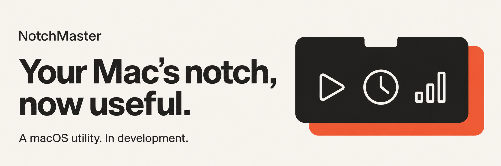
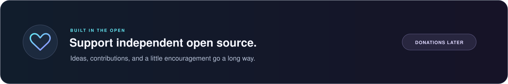

<p align="center">
  
</p>

<h1 align="center">NotchMaster</h1>

<h3 align="center">
  An expandable notch utility for Apple Silicon Macs, built with SwiftUI and AppKit. Plugin support is planned.
</h3>

<p align="center">
  
  
  
  
  <a href="LICENSE"></a>
</p>

<p align="center">
  <a href="#features">Features</a> ·
  <a href="#free--pro">Free &amp; Pro</a> ·
  <a href="#compatibility">Compatibility</a> ·
  <a href="#availability">Availability</a> ·
  <a href="#development">Development</a> ·
  <a href="#plugin-development">Plugins</a> ·
  <a href="#follow-development">Follow development</a> ·
  <a href="#support">Support</a>
</p>

<p align="center">
  
</p>

<p align="center"><sub>Concept artwork showing planned controls; not a screenshot of the current prototype.</sub></p>

<p align="center">
  <a href="#availability"></a>
</p>

> **Early prototype, not yet released.** On a supported built-in MacBook notch, NotchMaster currently offers a passive black notch preview with a live local clock and date when expanded, hover expansion and delayed collapse, adjustable animation speed, Reduce Motion support, and optional trackpad haptic requests. A native menu bar menu provides preview visibility, Settings and Quit controls; a temporary verification window remains available for development. There is no downloadable release or plugin SDK yet. The hero artwork and remaining feature plans below show the intended direction, not functionality already shipped.

## Features

NotchMaster aims to turn the MacBook notch into a useful, expandable hub. Development is incremental: each interaction is implemented and tested before larger features are added.

**Working in the current prototype**

- Compact black notch preview on supported built-in displays, with hover expansion and delayed collapse.
- Live local clock and date below the camera when expanded, with localized time and date formatting.
- Native AppKit animation, plus an expansion-speed preference saved in Settings.
- Reduce Motion support and optional native trackpad haptic requests on hover transitions.
- Native menu bar controls for Show/Hide Notch Preview, Open Settings and Quit, available after closing the verification window.
- Launch at Login in General Settings, backed by macOS registration status with approval guidance and visible errors.
- Temporary Show/Hide and Expand/Collapse controls for testing.

**Planned, not implemented yet**

- Compact and expanded plugin views with useful controls and information.
- A plugin registry and settings to enable or disable plugins.
- Optional Metal border effects and additional accessibility options.
- A virtual notch for Apple Silicon Macs without a physical display notch.
- Optional iCloud preference and layout sync as part of a potential Pro edition.

## Free & Pro

The intended model is a useful free core, with optional Pro features distributed through the Mac App Store. **No Pro edition, pricing, or purchase flow is available yet.** This is a proposed feature split, not a list of shipped entitlements.

| Planned capability | Free (proposed) | Pro (proposed) |
| :--- | :--- | :--- |
| Expandable notch and core controls | Planned | Included |
| Native settings and local preferences | Planned | Included |
| Plugin registry and enable/disable controls | Planned | Included |
| Expansion speed and optional Metal border effects | Planned | Included |
| Community plugins | Delivery undecided | App Store compatibility under review |
| Now Playing screensaver | - | Planned |
| iCloud preference and layout sync | - | Planned |
| Purchase restoration and sync controls | - | Planned |

The free edition is intended to work without a NotchMaster account. Proposed Pro sync would be opt-in and limited to approved preferences and layouts, never plugin code, credentials, or private plugin content. The feature split may change.

## Compatibility

NotchMaster currently targets **Apple Silicon (arm64) and macOS 14.0 or later**. The prototype requires a built-in physical notch with geometry that macOS reports as supported. A deployment target does not mean that every OS version or Mac has been tested.

| Hardware | Current prototype | Future direction |
| :--- | :--- | :--- |
| MacBook Air with M5 and a physical notch | Tested during development on macOS 27.2 | Continue hardware and OS validation |
| Other Apple Silicon MacBooks with a physical notch | Designed to work with supported display geometry; not verified on every model | Broader compatibility testing |
| Apple Silicon Macs without a physical notch (including desktops) | Not supported by the current notch preview | Virtual notch planned |
| Intel Macs | Not supported; the Xcode target is arm64-only | No Intel version planned |

The preview validates system-reported display geometry instead of guessing. Mirrored, inactive, or unsupported built-in displays do not show the preview. See [Architecture](docs/ARCHITECTURE.md) for implementation details and test coverage.

## Availability

**There is no public download or Mac App Store listing yet.** NotchMaster is still under development. Developers can [build the prototype from source](#development); a public release and Mac App Store distribution are goals, not announced dates.

## Development

The repository includes an Xcode project using Swift 6 language mode, SwiftUI, AppKit and complete concurrency checking. Open `NotchMaster.xcodeproj` in Xcode on an Apple Silicon Mac.

```sh
git clone https://github.com/louisboii747/NotchMaster.git
cd NotchMaster
open NotchMaster.xcodeproj
```

Build and run the focused preference, login-item, Settings, geometry, window-controller, hover, SwiftUI content and menu tests for Apple Silicon:

```sh
xcodebuild -project NotchMaster.xcodeproj -scheme NotchMaster -configuration Debug -destination 'platform=macOS,arch=arm64' build
xcodebuild -project NotchMaster.xcodeproj -scheme NotchMaster -configuration Debug -destination 'platform=macOS,arch=arm64' test
```

### Continuous integration

[macOS CI](.github/workflows/macos-ci.yml) runs on pull requests to `main`, pushes to `main`, and manual dispatch. Its separate jobs build and test the arm64 macOS app using Xcode 27 (treating Swift warnings as errors), and check SwiftLint plus SwiftFormat styling. CI does not replace manual physical-notch, haptic, or full-screen testing.

To run the same style checks locally, install the tools with `brew install swiftlint swiftformat` and run:

```sh
swiftlint lint --strict
swiftformat --lint .
```

To apply the configured formatting locally, run `swiftformat .` and review the diff before committing. SwiftLint and SwiftFormat use the deliberately small rule sets in `.swiftlint.yml` and `.swiftformat`; extend these rules incrementally as the codebase develops.

The prototype uses local ad hoc signing; distribution signing isn't configured. Click the monochrome MacBook symbol in the menu bar to show or hide the preview, open Settings, or quit. The preview starts hidden and the Show/Hide title follows the controller's confirmed visibility, including after sleep or an unsupported display change. Closing the verification window leaves the menu bar utility running. The app retains its Dock icon; reopen the development window through Window > NotchMaster to test manual expansion and collapse. Open Settings also has the standard Command-comma shortcut, and Quit uses Command-Q.

General Settings includes a native Launch at Login switch. It is off when macOS reports no registration, and on only when macOS confirms the app is enabled. Approval-required status offers Open Login Items Settings. Status refreshes when Settings appears and when the app or a window becomes active. No login Boolean is stored in preferences. Test actual login launching with a properly signed installed copy at a stable path; an ad hoc Xcode build does not establish that behaviour. See [login-item testing](docs/PROTOTYPE_TESTING.md#launch-at-login-checks).

The foundation window's buttons use a small macOS adaptation of [SwiftPieces ElasticButton](https://swiftpieces.com/docs/components/controls/elastic-button), retaining native Liquid Glass buttons on macOS 26 and later and native bordered buttons on earlier systems. Reduce Motion removes the press scaling, and Reduce Transparency selects the bordered treatment. The adapted component has a separate [SwiftPieces licence](SwiftPieces/LICENSE.txt).

For live clock behaviour, hover boundaries, animation, accessibility, haptics and manual testing, see **[Prototype testing](docs/PROTOTYPE_TESTING.md)**. For implementation details, see [Architecture](docs/ARCHITECTURE.md) and the [file map](docs/STRUCTURE.md).

| Path | Purpose |
| :--- | :--- |
| [`Sources/App/`](Sources/App/README.md) | App entry point, scenes and lifecycle. |
| [`Sources/Core/`](Sources/Core/README.md) | Preferences and window management; plugin infrastructure is planned. |
| [`Sources/UI/`](Sources/UI/README.md) | Settings and notch presentation. |
| [`docs/`](docs/STRUCTURE.md) | Architecture, testing notes and future plugin design. |

## Plugin development

A public plugin SDK, installable plugin format and stable third-party API **do not exist yet**. The [plugin guide](docs/PLUGINS.md) explains the design goals, lifecycle requirements and unresolved distribution decisions; it is not a tutorial for an existing SDK.

For now, [open an issue](https://github.com/louisboii747/NotchMaster/issues) explaining the plugin you'd like to build, its compact and expanded views, and any data or permissions it would need.

## Follow development

NotchMaster is being developed publicly in small, testable steps. You can **Watch** the [GitHub repository](https://github.com/louisboii747/NotchMaster) for updates, check [Releases](https://github.com/louisboii747/NotchMaster/releases) when builds become available, or browse [Issues](https://github.com/louisboii747/NotchMaster/issues) to suggest improvements and discuss ideas.

There is no beta sign-up or public download yet. When testing opens, details will be posted in the repository.

## Support

<p align="center">
  
</p>

<p align="center">
  <a href="https://github.com/louisboii747/NotchMaster"></a>
  
</p>

If you have a plugin idea or spot a problem in the docs, feel free to share it by [opening an issue](https://github.com/louisboii747/NotchMaster/issues). Pull requests for docs, structure, and artwork are welcome at this stage.

The donation button is inactive for now. Any future donations will support development and won't unlock Pro.

## Licence

[MIT](LICENSE) · © 2026 Louis Hinchliffe.

NotchMaster is an independent project and isn't affiliated with Apple. Apple, MacBook, macOS, iCloud, App Store, and Dynamic Island are trademarks of Apple Inc.
