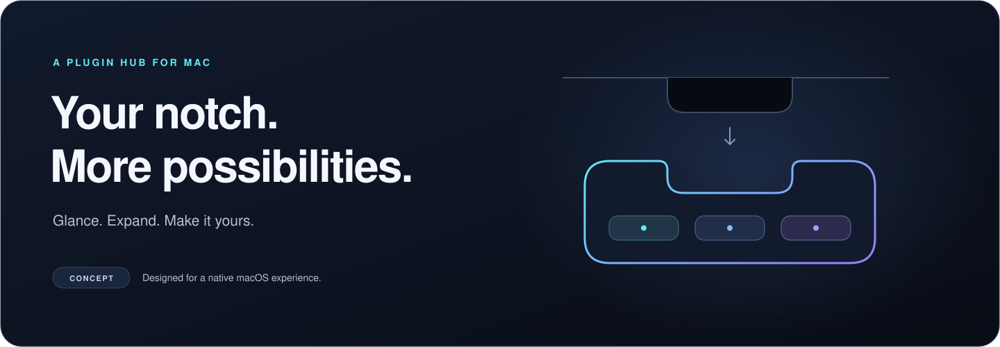

<p align="center">
  
</p>

<h1 align="center">NotchMaster</h1>

<p align="center">
  <strong>Your notch. More possibilities.</strong><br>
  An expandable, plugin-driven hub for your MacBook.
</p>

<p align="center">
  
  
  
  
  <a href="LICENSE"></a>
</p>

<p align="center">
  <a href="#the-idea">The idea</a> ·
  <a href="#free--pro">Free &amp; Pro</a> ·
  <a href="#repository">Repository</a> ·
  <a href="#how-to-build-plugins">Plugins</a> ·
  <a href="#support-open-source">Support</a>
</p>

<p align="center">
  
</p>

<p align="center">
  <a href="#availability"></a>
</p>

> **At the beginning.** This repository contains the project structure, brand assets, and design documentation. App implementation has not started. Features below describe the intended product; there is no runnable app, plugin SDK, or download yet. NotchMaster is a working title.

## The idea

Give the space around your MacBook's notch a purpose. NotchMaster is inspired by the glanceable, expanding interaction of Dynamic Island, reimagined for a native macOS utility.

Keep a compact hub at the top of your display. Expand it when you need more. Choose plugins that make it useful for your workflow.

| Design goal | Intended experience |
| :--- | :--- |
| **Glance, then expand** | Compact status with a larger surface for focused interaction. |
| **Make it yours** | Enable the plugins you want and keep the hub uncluttered. |
| **Feel at home on Mac** | SwiftUI controls, AppKit window management, and a native settings sidebar. |
| **Stay in control** | Adjustable expansion speed, optional border effects, and explicit launch-at-login consent. |
| **Keep the core local** | A useful free experience with optional Pro sync. |

## Free & Pro

**Proposed feature split.** Availability, pricing, and distribution will be confirmed during development.

| Capability | Free · open-source core | Pro · planned App Store upgrade |
| :--- | :---: | :---: |
| Expandable notch hub | Planned | Included with core |
| Native settings and local preferences | Planned | Included with core |
| Plugin registry and enable/disable controls | Planned | Included with core |
| Community plugin support | Planned; delivery model under design | Subject to App Store-compatible delivery |
| Expansion speed and optional Metal border effects | Planned | Included with core |
| iCloud sync for eligible preferences and layouts | — | Planned |
| Restore purchases and sync controls | — | Planned |

The free core is intended to work without a NotchMaster account. Pro sync is intended to be opt-in and tied to the user's iCloud account. Plugin binaries, credentials, and private plugin content are outside the proposed sync scope.

## Native by design

The settings window will follow macOS System Settings conventions: a two-column sidebar, native grouped forms, clear labels, and system typography.

| Category | Planned controls |
| :--- | :--- |
| **General** | Launch at Login; Dynamic Notch Expansion Speed. |
| **Advanced** | Enable Metal Border Shaders; accessibility-aware rendering. |
| **Installed Plugins** | Plugin name, descriptive subtitle, and a native enable/disable toggle. |
| **Pro Sync** | Upgrade card, purchase restoration, and iCloud sync status. |
| **About** | App identity, version information, licence, and project links. |

Read the [settings specification](docs/SETTINGS.md) for the complete interaction requirements.

## Repository

| Path | Purpose |
| :--- | :--- |
| [`Sources/App/`](Sources/App/README.md) | Future macOS entry point, scene composition, and app lifecycle. |
| [`Sources/Core/`](Sources/Core/README.md) | Future plugin registry, window coordination, and state services. |
| [`Sources/UI/`](Sources/UI/README.md) | Future settings interface, notch views, and materials. |
| [`docs/`](docs/STRUCTURE.md) | File map, architecture, settings, plugin guidance, and branding. |

Each source directory contains an ownership note so Git preserves the structure. These folders describe responsibilities; they are not configured build targets yet.

### Getting started

Clone the repository and start with the design documents:

```sh
git clone https://github.com/louisboii747/NotchMaster.git
cd NotchMaster
```

1. Read the [file map](docs/STRUCTURE.md).
2. Review the [architecture](docs/ARCHITECTURE.md) and [settings specification](docs/SETTINGS.md).
3. Explore the [plugin development guide](docs/PLUGINS.md).

There is no Xcode project, workspace, or Swift package at this stage, so no build command applies. Swift 6, SwiftUI, and AppKit are the planned stack. The minimum macOS version and Xcode toolchain will be fixed when the application target is created.

The ignore rules cover Xcode state, DerivedData, SwiftPM products, local build overrides, and signing credentials. Shared project configuration, schemes, entitlements, and an app's `Package.resolved` remain eligible for version control.

## How to build plugins

The plugin SDK and package format are still being designed. There is no supported plugin build or installation command yet.

You can prepare a plugin proposal now:

1. Define one useful interaction and its compact and expanded presentations.
2. Document its data sources, permissions, refresh behaviour, and offline behaviour.
3. Plan explicit enable/disable handling and complete cleanup when disabled.
4. Open a [feature proposal](https://github.com/louisboii747/NotchMaster/issues) with those details.

Start with the [plugin development guide](docs/PLUGINS.md) for the proposed lifecycle, capability model, and acceptance criteria. Community code loading and Mac App Store distribution require separate design decisions; no third-party execution model is committed yet.

## Roadmap

- [x] Repository layout and source ownership.
- [x] Brand assets, README, and MIT licence.
- [x] Initial architecture, settings, and plugin specifications.
- [ ] Create the macOS application target and pin the toolchain.
- [ ] Implement the native settings window and persistent preferences.
- [ ] Prototype notch geometry, window behaviour, and expansion on real Macs.
- [ ] Establish the plugin contract and implement bundled reference plugins.
- [ ] Validate community distribution and App Store boundaries.
- [ ] Add StoreKit entitlements and opt-in iCloud sync.

## Availability

NotchMaster has no published release or Mac App Store listing. The badge above is a clearly labelled release-intent graphic, not a download link or an Apple approval mark. A deployment target, hardware compatibility matrix, price, and release date have not been announced.

## Contributing

Architecture feedback, plugin ideas, accessibility requirements, and design refinements are welcome. [Open an issue](https://github.com/louisboii747/NotchMaster/issues) to discuss a focused change, or submit a pull request with a clear description and relevant verification.

For this initialization phase, contributions should focus on structure, documentation, and assets. App code belongs in the implementation phase.

## Support open source

<p align="center">
  
</p>

<p align="center">
  <a href="https://github.com/louisboii747/NotchMaster"></a>
  
</p>

Stars, thoughtful issues, and contributions help the project take shape. A donation option is planned; no payment destination is connected yet. Donations will support development and will not unlock Pro features.

## Licence

[MIT](LICENSE) · © 2026 Louis Hinchliffe.

NotchMaster is an independent project and is not affiliated with or endorsed by Apple. Apple, MacBook, macOS, iCloud, App Store, and Dynamic Island are trademarks of Apple Inc.
