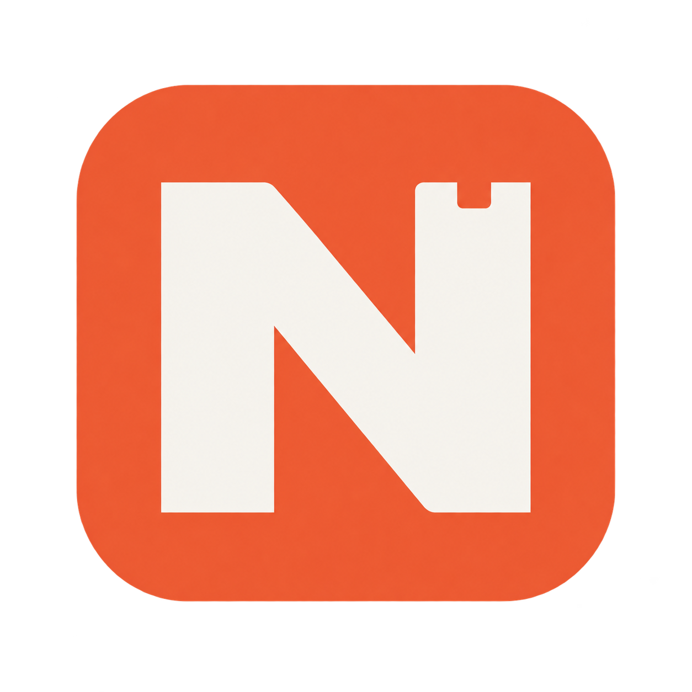
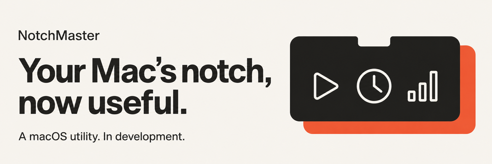
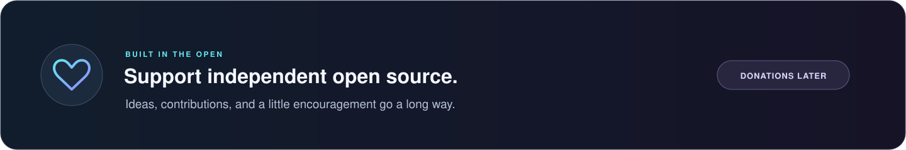

<p align="center">
  
</p>

<h1 align="center">NotchMaster</h1>

<p align="center">
  An expandable plugin hub for your MacBook's notch.
</p>

<p align="center">
  
  
  
  
  <a href="LICENSE"></a>
</p>

<p align="center">
  <a href="#features">Features</a> ·
  <a href="#free--pro">Free &amp; Pro</a> ·
  <a href="#development">Development</a> ·
  <a href="#how-to-build-plugins">Plugins</a> ·
  <a href="#support">Support</a>
</p>

<p align="center">
  
</p>

<p align="center">
  <a href="#availability"></a>
</p>

> **Planning stage.** This repo contains the structure, docs, and artwork. There's no runnable app or plugin SDK yet. Everything below describes the plan. NotchMaster is a working title.

## Features

I'm building NotchMaster to bring Dynamic Island-style interactions to the Mac. The hub will sit around the MacBook notch and expand to show controls and information from the plugins you enable.

- Compact and expanded views for each plugin.
- Native settings for launch at login, expansion speed, and plugin controls.
- Optional Metal border effects with accessibility fallbacks.
- Local preferences, with optional iCloud sync through Pro.

## Free & Pro

The plan is to keep the core free and offer iCloud sync and additional features as a Pro upgrade through the Mac App Store. Pricing and plugin delivery are still undecided.

| Feature | Free | Pro |
| :--- | :--- | :--- |
| Expandable notch with extensive controls | Included | Included |
| Now playing screensaver | Not Included | Included |
| Native settings and local preferences | Included | Included |
| Plugin registry and enable/disable controls | Included | Included |
| Expansion speed and Metal border effects | Included | Included |
| Community plugins | Planned; packaging undecided | App Store delivery under review |
| iCloud preference and layout sync | Not included | Included |
| Purchase restoration and sync controls | Not applicable | Included |

Free features won't require a NotchMaster account. Pro sync would use iCloud and require opt-in. Sync will cover approved preferences and layouts; plugin code, credentials, and private plugin content will stay out of it.

All features are subject to change.

## Settings

The settings window will use a sidebar and grouped forms, following macOS System Settings conventions.

| Category | Controls |
| :--- | :--- |
| General | Launch at Login and Dynamic Notch Expansion Speed. |
| Advanced | Enable Metal Border Shaders and rendering options. |
| Installed Plugins | Plugin names, descriptions, and enable/disable switches. |
| Pro Sync | Upgrade, restore purchases, and check iCloud sync status. |
| About | Version, licence, and project links. |

The [settings spec](docs/SETTINGS.md) covers the layout and behaviour in detail.

## Development

The planned stack is Swift 6, SwiftUI, and AppKit. An Xcode project or Swift package will be added when app work starts. The minimum macOS version and toolchain are still undecided.

```sh
git clone https://github.com/louisboii747/NotchMaster.git
cd NotchMaster
```

| Path | Purpose |
| :--- | :--- |
| [`Sources/App/`](Sources/App/README.md) | App entry point, scenes, and lifecycle. |
| [`Sources/Core/`](Sources/Core/README.md) | Plugin registry, window management, and state. |
| [`Sources/UI/`](Sources/UI/README.md) | Settings, notch views, and materials. |
| [`docs/`](docs/STRUCTURE.md) | File map, architecture, settings, and plugin notes. |

The source folders contain ownership notes for now. Start with the [file map](docs/STRUCTURE.md) and [architecture](docs/ARCHITECTURE.md) for the proposed implementation.

## How to build plugins

The SDK doesn't exist yet. The [plugin guide](docs/PLUGINS.md) records the proposed lifecycle, permissions, and cleanup requirements. Third-party code loading and App Store packaging still need to be decided.

For now, [open an issue](https://github.com/louisboii747/NotchMaster/issues) describing what your plugin would do, what it should show in each view, and which data or permissions it would need.

## Roadmap

- [x] Set up the repository, docs, and initial artwork.
- [ ] Create the macOS target and choose the toolchain.
- [ ] Build the settings window and save preferences.
- [ ] Test notch layout and window behaviour on real Macs.
- [ ] Define the plugin API and build bundled examples.
- [ ] Decide how community plugins and App Store distribution will work.
- [ ] Add Pro purchases and opt-in iCloud sync.

## Availability

There's no release date, download, or App Store listing yet. OS and hardware support will be confirmed once there's a build to test.

## Support

<p align="center">
  
</p>

<p align="center">
  <a href="https://github.com/louisboii747/NotchMaster"></a>
  
</p>

If you've got a plugin idea or spot a problem in the docs, [open an issue](https://github.com/louisboii747/NotchMaster/issues). Pull requests for docs, structure, and artwork are welcome at this stage.

The donation button is inactive for now. Any future donations will support development and won't unlock Pro.

## Licence

[MIT](LICENSE) · © 2026 Louis Hinchliffe.

NotchMaster is an independent project and isn't affiliated with Apple. Apple, MacBook, macOS, iCloud, App Store, and Dynamic Island are trademarks of Apple Inc.
